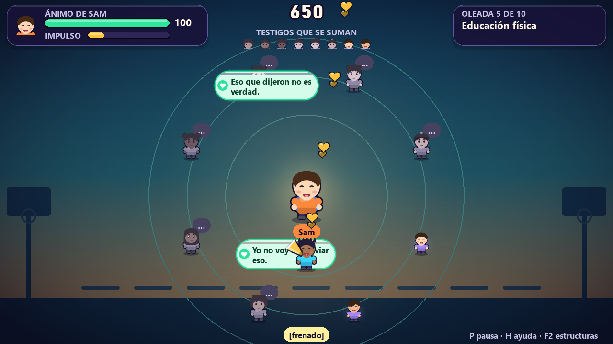
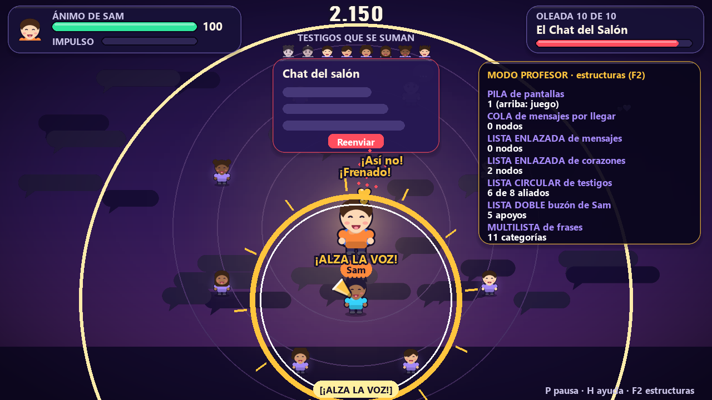

# Alza la Voz

Juego serio en Python para estudiantes de 10 a 15 años. Sam está en el centro de la pantalla y le llegan mensajes desde todos los bordes. Los de acoso tienen picos y hay que frenarlos con corazones; los de apoyo son redondos y verdes, y hay que dejarlos llegar. Cada diez puntos de valentía, uno de los ocho testigos que solo miraban se suma y empieza a defender a Sam.

Proyecto final de Estructura de Datos I (2026-30), Universidad del Norte. Profesor: Ricardo Villanueva Polanco.



## Cómo jugar

Hace falta Python 3.10 o superior.

```
pip install pygame-ce
python juego.py
```

| Tecla | Acción |
|---|---|
| W A S D o flechas | Moverse |
| Clic sostenido | Lanzar corazones |
| Espacio | "¡Alza la voz!" (con el impulso lleno) |
| P o Esc | Pausa; con las flechas se recorre el buzón de Sam |
| H | Ayuda |
| F1 | Alto contraste |
| F2 | Panel con el estado de cada estructura de datos |

La partida tiene diez oleadas, cada una en un lugar distinto del colegio, y termina con un jefe: El Chat del Salón.

## Estructuras de datos

Todas están hechas a mano con nodos en `estructuras.py`, sin usar las listas de Python como pila o cola.

| Estructura | Uso en el juego |
|---|---|
| Cola | Mensajes programados de cada oleada |
| Pila | Pantallas abiertas (menú, juego, pausa, ayuda) |
| Lista enlazada | Mensajes, corazones y chispas en pantalla |
| Lista circular | Los ocho testigos alrededor de Sam |
| Lista doble | Buzón con los apoyos que recibió Sam |
| Multilista | Banco de frases: 11 categorías con su lista |
| Archivos | `datos/textos.json` (frases) y `datos/records.csv` (cinco mejores puntajes) |



## Archivos

- `juego.py`: lógica, pantallas y eventos.
- `estructuras.py`: las seis estructuras.
- `arte.py`: personajes, escenarios e iconos dibujados por código, sin imágenes externas.
- `pruebas/`: pruebas de las estructuras, un bot que juega partidas completas, cinco perfiles de jugador simulados y la medición de balance y rendimiento.
- `informe/`: informe final en formato IEEE (español e inglés) y su fuente LaTeX.

```
python pruebas/test_estructuras.py
python pruebas/simulacion.py
python pruebas/usabilidad_bots.py
python pruebas/balance_y_rendimiento.py
```

## Equipo: Nodo Sano Studios

- Felipe Raúl Ríos García (gerencia)
- Josue Salas Mercado (código y diseño)
- Gustavo Parody Cifuentes (documentación)
- Camilo Andrés Meriño Narváez (pruebas)
- Avid Andrés Avila Rojano (UI/UX)
